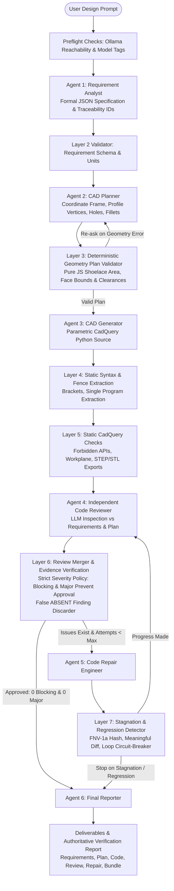

# FutureCAD — Multi-Agent AI CAD Engineering Platform

FutureCAD is a client-side, browser-based multi-agent CAD engineering platform that converts natural language mechanical engineering specifications into parametric, executable **CadQuery Python source code**.

It operates with a **pure browser architecture** communicating directly with a local **Ollama** instance via streaming HTTP APIs. There is **no backend server**, no Node/Express/Python runtime server, no database, and no external paid API dependencies.

---

## 1. System Architecture



---

## 2. Layered Validation Taxonomy

To eliminate hallucinations, non-viable geometry, and false approvals, FutureCAD implements **seven distinct verification layers**:

| Layer | Responsibility | Mechanism | Can Prove / Cannot Prove |
|---|---|---|---|
| **Layer 1: Strict JSON Parsing** | Validates JSON format from LLM output, extracting from fences or object boundaries. | `parseJsonStrict` in `validators.js` | Proves valid JSON; cannot prove semantic correctness. |
| **Layer 2: Requirement Validation** | Enforces requirement schemas, dimensions, units, features, explicit vs provisional tracking. | `validateRequirements`, `convertUnit` | Proves schema & unit validity; cannot prove mechanical feasibility. |
| **Layer 3: Deterministic Geometry Plan Validation** | Deterministic geometric checks before code generation: positive dimensions, finite coordinates, non-zero polygon area (Shoelace formula), hole placement within face bounds, edge clearances, and fillet radius vs wall thickness. | `validateGeometryPlan` | Proves geometric consistency & boundary containment; cannot prove OpenCascade B-Rep topology. |
| **Layer 4: Python Syntax Scanning** | Scans bracket balance `([{`, string quotes, comments, and program completeness. | `scanPython`, `checkComplete`, `extractFirstProgram` | Proves syntax structural balance; cannot prove runtime Python execution. |
| **Layer 5: Static CadQuery Checks** | Detects invented/deprecated APIs (`extrude_bidir`, `fillet_edges`, `cutHole`), missing `cq.Workplane`, and missing STEP/STL exports. | `staticChecks` | Proves standard CadQuery API usage; cannot prove solid geometry. |
| **Layer 6: Review Merger & Evidence Check** | Cross-checks reviewer claims against source code, discarding fabricated evidence or false `ABSENT:` findings. Enforces strict severity policy: **BLOCKING and MAJOR issues prevent approval**. | `verifyAbsentClaim`, `mergeReview` | Proves review integrity & eliminates hallucinations; does not execute code. |
| **Layer 7: Repair Stagnation Analysis** | Computes 32-bit FNV-1a code hashes before/after repair, normalizes code to check for meaningful diffs, tracks resolved vs unresolved issues, and halts on stagnation or regressions. | `analyzeRepairAttempt` | Guarantees repair loop termination; prevents infinite loops. |

---

## 3. BEFORE vs. AFTER Architectural Comparison

| Dimension | BEFORE Overhaul | AFTER Overhaul |
|---|---|---|
| **Reviewer Approval Policy** | **Buggy:** `approved = !kept.some(i => i.severity === 'blocking')`. MAJOR issues were completely ignored for approval! Code with severe geometric defects received `approved: true`. | **Strict Enforcement:** `approved = !hasBlocking && !hasMajor`. Both BLOCKING and MAJOR issues prevent approval. Only MINOR/INFO allow approval. |
| **Evidence & ABSENT Findings** | Blindly kept any issue starting with `ABSENT:`, allowing the LLM reviewer to hallucinate missing features that were already present in the code. | `verifyAbsentClaim` programmatically tests if the feature/token exists in source. Hallucinated ABSENT claims are discarded into `discarded_issues`. |
| **Issue Identifiers & Metadata** | Raw issues lacked stable IDs, categories, expected behavior, actual behavior, or verification status. | Every issue receives a stable ID (`ISSUE-001`, `STATIC-001`), category (`syntax`, `api`, `geometry`, `dimensions`, etc.), evidence, explanation, expected/actual behaviors, and verification status. |
| **CAD Plan Validation** | Superficial 15-line type check. Did not validate coordinates, dimensions, holes, or geometry. | **Deterministic Geometry Plan Validator (`validateGeometryPlan`)**: Checks positive dimensions, units, non-zero polygon profile area via Shoelace formula, hole face containment, edge breakout clearance, and fillet feasibility against wall thickness. |
| **Repair Orchestration** | Blindly iterated up to `maxRepairs` with only `code !== before`. Stagnant or identical code was repeatedly passed back to the reviewer. | **Intelligent Stagnation Circuit-Breaker**: Tracks FNV-1a hashes before and after, detects comment-only diffs, tracks resolved/unresolved/new issues, and halts immediately on identical code, no meaningful change, repeated unresolved issues, or regressions. |
| **CadQuery Reference Patterns** | Only 1 brief L-bracket snippet with hardcoded parameters. | 12 verified standard reference patterns in `prompts.js` covering box primitives, L-brackets, vertical holes, horizontal holes, BoxSelector fillets, chamfers, hollow profiles, stepped shafts, counterbores, and slots. |
| **Ollama Streaming & Accounting** | Stream chunks were counted as `tokens++` (inaccurate). Drops or premature closes were silently accepted. | Uses actual `eval_count` when done; estimates tokens based on character length during streaming; detects premature stream drops (`OllamaError('incomplete')`). |
| **Workflow Terminal Status** | If repair failed to resolve issues, `s.status` was set to `'completed'`. Failed agents were counted as 100% complete in the progress bar. | Failed agents contribute 0% to progress; unresolved workflows finish with status `'unresolved'` and display partial progress. Completed status is reserved for approved workflows. |
| **Deliverables & UX** | Displayed raw JSON dumps in tabs. | Formatted, structured engineering views for Requirements, CAD Plan, Code Review, Repair Log, and Final Report, with full raw JSON preserved. Added `plan_validation.json` deliverable. |
| **Regression Testing** | Zero automated tests existed in the repository. | **144 automated regression tests** covering all specifications A through DD via CLI (`node test_suite.js`) and in-browser runner (`test.html`). |

---

## 4. Confirmed Bugs Fixed

1. **Reviewer Approval Bug (`validators.js:mergeReview`):**
   * *Problem:* `approved` was calculated strictly from `!kept.some(i => i.severity === 'blocking')`. If an issue had severity `major`, the code was marked `approved: true`, bypassing repair and falsely claiming approval.
   * *Fix:* Enforced `approved = !hasBlocking && !hasMajor`. Both BLOCKING and MAJOR issues prevent approval.
2. **False ABSENT Findings Hallucination:**
   * *Problem:* `mergeReview` checked `/^ABSENT:/i.test(ev)` and unconditionally kept the issue, allowing LLMs to falsely claim STEP export, imports, or holes were absent when present.
   * *Fix:* Implemented `verifyAbsentClaim(ev, code)` to cross-examine claims against actual syntax and AST tokens.
3. **Repair Infinite / Blind Looping:**
   * *Problem:* Repair loop ran blindly up to `maxRepairs` without checking whether code changed or if the repair agent was stalled.
   * *Fix:* Implemented `analyzeRepairAttempt` to detect identical code, non-meaningful edits, repeated unresolved issues, and regressions.
4. **Progress Calculation & Terminal Status Bug:**
   * *Problem:* Failed agents (`error`) were assigned `1` in progress calculation, displaying `100% · completed` even when agents failed.
   * *Fix:* Failed agents contribute `0` to progress, and terminal status accurately distinguishes `completed`, `unresolved`, `failed`, and `cancelled`.
5. **Stream Chunk Token Count Inaccuracy:**
   * *Problem:* `ollama.js` treated each NDJSON stream chunk as 1 token (`tokens++`).
   * *Fix:* Utilizes `o.eval_count` from Ollama's completion payload and calibrated character-length estimation during streaming.
6. **Geometry Out-of-Bounds Blindness:**
   * *Problem:* CAD planner could generate holes with centers outside the part or fillets with radii larger than the arm thickness.
   * *Fix:* Deterministic plan validator rejects out-of-bounds holes (`PLAN-HOLE-OUTSIDE-BB`), edge breakouts (`PLAN-HOLE-EDGE-BREAKOUT`), and oversize fillets (`PLAN-FILLET-EXCEEDS-THICKNESS`).

---

## 5. Running the Application

### Serve Locally (Static Files Only)
```bash
# From the repository root:
python3 -m http.server 8000
# Open http://localhost:8000 in your browser
```

### Ollama Configuration & CORS
The frontend calls Ollama (`http://localhost:11434`) directly via `fetch`. If running on a remote host or non-standard port, configure `OLLAMA_ORIGINS`:
```bash
# Linux (systemd):
sudo systemctl edit ollama
# Add:
# Environment="OLLAMA_ORIGINS=http://localhost:8000,http://127.0.0.1:8000"
sudo systemctl restart ollama

# Manual startup:
OLLAMA_ORIGINS="http://localhost:8000" ollama serve
```

### Recommended Ollama Models
- **Analyst & Reporter:** `gemma4:e4b`
- **CAD Planner & Generator:** `hf.co/mradermacher/FutureCAD-7B-GGUF:Q4_K_M`
- **Reviewer & Repair:** `qwen2.5-coder:7b`

---

## 6. Verification & Regression Test Suite

FutureCAD includes an automated regression test suite covering specifications **A through Z**:

- **A.** Requirement Extraction Schema Validation
- **B.** Missing Dimensions & Provisional Status Tracking
- **C.** Unit Conversion (`mm`, `cm`, `m`, `in`)
- **D.** Geometry Plan Validation (Valid Plan)
- **E.** Invalid Coordinates & Negative Dimensions Rejection
- **F.** Hole Centers Outside Faces & Edge Clearance Breakouts
- **G.** Bounding Box Consistency & Range Inversion
- **H.** Missing Feature Parameters & Degenerate Profiles (Shoelace Formula)
- **I.** Reviewer Severity Policy Enforcement (BLOCKING & MAJOR)
- **J.** False ABSENT Finding Detection & Discarding
- **K.** Repair Stagnation Detection (Non-meaningful Edits)
- **L.** Identical Code Output Detection
- **M.** Repeated Unresolved Issues Circuit-Breaker
- **N.** Workflow Cancellation via AbortController
- **O.** Failed Agent Status Handling
- **P.** Progress Calculation Accuracy
- **Q.** Duplicate Python Code Block Extraction
- **R.** Incomplete Model Output & Syntax Scanning
- **S.** Ollama Connection Error Classification
- **T.** Final Report Accuracy & Verification Honesty
- **U.** P0 Fix: Hole Material Membership (Point-in-Polygon), Empty Quadrant Rejection & 3D Coordinates
- **V.** P0 Fix: Lexical Code Analysis (Distinguishing Executable Calls from Comments and String Literals)
- **W.** P1 Fix: 2D Polygon Profile Topology (Bow-Tie Self-Intersection, Zero Edges, Degeneracy)
- **X.** P1 Fix: Deep Plan Validation (Integer Solid Count & Critical Field Requirements)
- **Y.** P1 Fix: Fillet vs Chamfer Validation (Positive Dimensions & Topological Warnings)
- **Z.** Deterministic Precedence over LLM Reviewer Approval
- **AA.** V2.1.1 Patch: Perpendicular-Plane Hole Boundary Clearance & L-Bracket Face Breakouts
- **BB.** V2.1.1 Patch: Calibrated Fillet/Chamfer Classification (Internal Corner vs External Edge)
- **CC.** V2.1.1 Patch: Malformed JSON Robustness (Null Entries, Corrupted Coordinates, Missing Fields)
- **DD.** V2.1.2 Patch: Nuanced Target Description Classification (External Corner, Ambiguous, Contradictory)

### Run Tests via CLI:
```bash
node test_suite.js
```
*Result: 144 PASSED, 0 FAILED.*

### Run Tests in Browser:
Open `http://localhost:8000/test.html` or click the **🧪 Run Test Suite** chip in the application header.

---

## 7. Verification Honesty & Known Limitations

1. **No Browser Python Execution:**
   The browser runtime does not execute Python or the OpenCascade CAD kernel. Reviewer approval denotes *static, structural, and LLM-assisted verification only*.
2. **Verification Flags:**
   The UI, downloads, and final reports always truthfully label Python execution, geometry validity, and STEP/STL exports as **NOT VERIFIED** until executed locally.
3. **To Generate Physical CAD Models:**
   ```bash
   pip install cadquery
   python generated_cad.py
   # Opens or inspects part.step and part.stl in FreeCAD or CAD viewers
   ```

---

## 8. Recommendations for Future Development

- **OpenCascade.js (WASM) Kernel Integration:** Compile a lightweight WebAssembly build of OpenCascade.js to execute geometry generation directly inside a Web Worker.
- **Three.js STL/B-Rep Viewer:** Add an interactive 3D WebGL viewport to inspect generated geometry meshes once WebAssembly execution is integrated.
- **Provider Abstraction Layer:** Implement model adapter interfaces allowing pluggable backends (e.g. llama.cpp server, LocalAI) without altering agent workflow logic.
